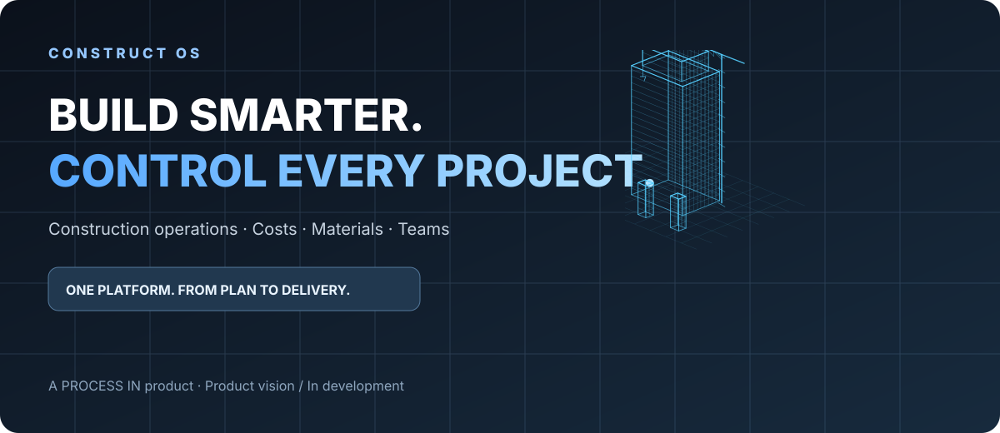

[Македонски](README.mk.md) · [English](README.md) · [Shqip](README.sq.md) · [Türkçe](README.tr.md)

# CONSTRUCT OS — Софтвер за управување со градежни проекти

[English](README.md) · [PROCESS IN](https://processin.mk)

**Статус: во развој.** Ова е опис на планираната функционална архитектура, а не тврдење дека сите модули се јавно достапни.

## Градежни проекти, материјали, тимови и трошоци — поврзани

**CONSTRUCT OS** е SaaS платформа во развој од **PROCESS IN**, наменета за градежни компании, инвеститори, раководители на градилишта и проектни менаџери.

Основниот фокус е управување со изведбата на градежни проекти: планирање, активности, рокови, материјали, набавки, подизведувачи, ресурси, буџети и реални трошоци.

## Главни планирани модули

### Проекти и градилишта
Портфолио на проекти, фази, активности, рокови, пресвртници и следење на реализацијата.

### Планирање на изведба
Задачи, зависности, календар на активности и организација на работата на терен.

### Материјали и набавки
Потребни количини, набавки, добавувачи, испораки и потрошувачка по проект.

### Подизведувачи и тимови
Распределба на задачи, ангажмани, одговорности и евиденција на извршена работа.

### Опрема и механизација
Распределба на машини, опрема и други ресурси по градилиште и проект.

### Буџети и контрола на трошоци
Планирани и реализирани трошоци, отстапувања, обврски и финансиска видливост.

### Документи и одобрувања
Проектни датотеки, промени, барања, одлуки и документациска историја.

### Извештаи и аналитика
Преглед на портфолиото, напредок, трошоци, ризици и оперативни показатели.

### Продажба на недвижности — изборен модул
Евиденција на станбени и деловни единици, достапност и продажни процеси. Ова не е основната функција на производот.

## Предвиден работен процес

| Фаза | Цел |
|---|---|
| **01 — Подготви проект** | Дефинирај опфат, фази, буџет и одговорности. |
| **02 — Планирај** | Организирај активности, материјали и рокови. |
| **03 — Набави** | Поврзи добавувачи, количини и набавки со проектот. |
| **04 — Изведувај** | Следи работа на тимови и подизведувачи. |
| **05 — Контролирај** | Спореди напредок и реални трошоци со планот. |
| **06 — Предај** | Подготви завршна документација и резултати. |

## За кого е наменет?

Градежни компании, генерални изведувачи, инвеститори, проектни менаџери, раководители на градилишта и компании со повеќе паралелни проекти.

## Што CONSTRUCT OS не е?

Не е замена за целосно законско сметководство или систем за пресметка на плати. Управувањето со градежна оперативност и трошоци останува главната намена.

## Архитектура и локализација

Планиран е повеќекориснички SaaS со изолација по организација, улоги, дозволи и претплатнички пакети. Предвидени јазици: македонски, англиски и албански.

## Статус на развој

Производот е во развој. Реални слики од системот, потврдени модули и комерцијални информации ќе се објавуваат со напредувањето на имплементацијата.

**[PROCESS IN — производител](https://processin.mk)**

*Овој репозиториум е јавна презентација на производот, не изворниот код на комерцијалната апликација.*
